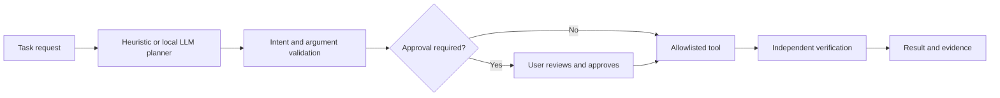

# AutoPilot AI

### A local-first computer-use agent for Windows

Plan a task, use an approved computer tool, and verify the result.

Maintainer: [Renish](https://github.com/renish7606) | [GitHub repository](https://github.com/renish7606/Autopilot-AI)

AutoPilot AI is a local-first Windows agent that performs bounded computer tasks through an allowlisted tool system. A local Ollama model can help interpret requests; deterministic checks enforce tool arguments and permissions. No paid AI API is required.

## Contents

- [How it works](#how-it-works)
- [Current capabilities](#current-capabilities)
- [Requirements](#requirements)
- [Installation](#installation)
- [Run the agent](#run-the-agent)
- [Run the dashboard](#run-the-dashboard)
- [Approvals and directory access](#approvals-and-directory-access)
- [Tests](#tests)
- [Data and privacy](#data-and-privacy)
- [Known limitations](#known-limitations)

## How it works

Each task follows the same safety-oriented flow:

1. Interpret the request with the deterministic planner or ask the local Ollama model to propose a plan.
2. Validate the plan and its arguments against the supported tools and policies.
3. Request approval for operations that launch apps, change files, run higher-risk commands, or control the desktop.
4. Execute the registered tool.
5. Independently check the result and report completion only when verification passes.

Ollama proposes plans; it does not execute actions or bypass deterministic validation. The project uses one local model at a time.

## Current capabilities

| Capability | Current behavior |
| --- | --- |
| File search | Recursively searches filenames under the workspace and approved directories; supports names and extensions such as PDF, DOCX, and images. It does not search document contents. |
| Directory listing | Lists immediate entries in the primary workspace. |
| File reading | Reads supported text and code formats and extracts text from PDFs. Results are size-limited and checked against a fresh disk read. |
| PDF viewing | Opens an approved PDF with the Windows default PDF application. Requires approval and verifies that the active window title identifies the PDF. Say **Read filename.pdf** to extract its text instead. |
| File changes | Creates directories, copies files without overwriting, and creates, appends to, or overwrites text files under approved roots. Requires approval and verifies the result. |
| Browser | Opens public HTTP/HTTPS pages in a fresh, headless Playwright session and returns visible page text. It does not use your regular browser profile or sign-in. |
| Web search | Searches public web providers through the free DDGS package. No API key is required; internet access is. |
| Windows desktop | Reads the foreground window through UI Automation, with a screenshot fallback. One explicitly requested mouse or keyboard action is available with approval. |
| Application launch | Launches supported installed Windows applications. The first launch requires approval; a successful app approval is saved locally. |
| Command runner | Runs commands from an approved working directory. A small set of inspection commands runs without approval; other commands require approval and are subject to command-pattern checks. |
| Task history | Stores task history locally in SQLite. Interactive CLI sessions can retain temporary numbered-result context while the process is running. |

Multi-step file workflows are bounded. They verify each step and stop when a required step fails. This is not yet a general-purpose agent that can dynamically use every tool for arbitrary workflows.

## Requirements

- Windows 10 or 11
- Python 3.10 or newer
- Node.js and npm to build the dashboard or run its development server
- Ollama is optional; use the heuristic planner without it
- Free disk space on D: for the virtual environment, dependencies, browser files, and local model

## Installation

The commands below use **D:\Agent** as the project location and put large downloads under **D:\Agent\down**.

~~~powershell
Set-Location D:\Agent

New-Item -ItemType Directory -Force .\down | Out-Null
python -m venv .venv
.\.venv\Scripts\Activate.ps1

$env:PIP_CACHE_DIR = "D:\Agent\down\pip-cache"
$env:PLAYWRIGHT_BROWSERS_PATH = "D:\Agent\down\playwright-browsers"

python -m pip install --upgrade pip
python -m pip install -r requirements.txt
python -m playwright install chromium
~~~

If PowerShell blocks virtual-environment activation, run this in the same window, then activate:

~~~powershell
Set-ExecutionPolicy -Scope Process -ExecutionPolicy RemoteSigned
.\.venv\Scripts\Activate.ps1
~~~

Run Python commands from the project root. This prevents pytest from collecting unrelated files elsewhere on the computer.

## Run the agent

Use the deterministic planner to try a supported task without Ollama:

~~~powershell
python -m autopilot_ai.cli "Show me the files in this folder" --planner heuristic
~~~

To use local model planning, make sure Ollama is running and the configured model is installed:

~~~powershell
ollama list
$env:AUTOPILOT_MODEL = "qwen2.5:0.5b"
python -m autopilot_ai.cli "Show me the files in this folder" --planner ollama
~~~

The planner defaults to **qwen2.5:0.5b** and connects to **http://127.0.0.1:11434**. Set AUTOPILOT_MODEL to select another model already installed in Ollama. If Ollama is unavailable or its plan does not match the validated intent, supported requests may use the deterministic fallback.

### Example requests

~~~powershell
# List the workspace
python -m autopilot_ai.cli "Show me the files in this folder" --planner heuristic

# Search filenames and file types
python -m autopilot_ai.cli "Find files containing budget" --planner heuristic
python -m autopilot_ai.cli "Find PDFs" --planner heuristic
python -m autopilot_ai.cli "Show PDFs in ML" --planner heuristic

# Read PDF text, or open a PDF in the Windows viewer
python -m autopilot_ai.cli "Read C:\Users\ASUS\Downloads\Renish_Resume.pdf" --planner heuristic
python -m autopilot_ai.cli "Open C:\Users\ASUS\Downloads\Renish_Resume.pdf" --planner heuristic

# Read a public web page or search the public web
python -m autopilot_ai.cli "Open https://example.com" --planner heuristic
python -m autopilot_ai.cli "Search the web for Python 3.12 release notes" --planner heuristic

# Inspect the foreground window; the delay lets you switch to another app
python -m autopilot_ai.cli "Inspect active window" --planner heuristic --delay-seconds 5

# Print the full structured report, including verification evidence
python -m autopilot_ai.cli "Find files containing budget" --planner heuristic --debug
~~~

A PDF request may ask for clarification if multiple approved files share the same name. Use its full path to identify the intended file.

### Interactive CLI

Start a conversation that retains short-term selection context until you exit:

~~~powershell
python -m autopilot_ai.cli --interactive --planner heuristic
~~~

When AutoPilot presents numbered file or folder matches, reply with a number or ordinal such as **the second one**. A selection identifies a path; it does not open or change that file. Type **exit** or **quit** to end the session.

Task history is stored locally. View recent history or a specific session:

~~~powershell
python -m autopilot_ai.cli --history
python -m autopilot_ai.cli --history SESSION_ID
~~~

To resume a conversation session, provide its ID when starting interactive mode:

~~~powershell
python -m autopilot_ai.cli --interactive --planner heuristic --resume SESSION_ID
~~~

### Approve a planned operation

Review the plan before approving it. For CLI tasks, repeat the request with **--approve**:

~~~powershell
# Preview first
python -m autopilot_ai.cli "Create folder reports" --planner heuristic

# Review the plan, then approve the same request
python -m autopilot_ai.cli "Create folder reports" --planner heuristic --approve

# Opening a PDF also requires approval
python -m autopilot_ai.cli "Open C:\Users\ASUS\Downloads\Renish_Resume.pdf" --planner heuristic --approve
~~~

In the dashboard, use the approval control shown for the pending operation.

## Run the dashboard

### Production-style local dashboard

Build the frontend, then start the local server:

~~~powershell
.\build.ps1
python -m autopilot_ai.web
~~~

Open **http://localhost:8000**.

### Frontend development mode

Run the backend and Vite frontend in separate PowerShell windows:

~~~powershell
# Terminal 1: backend
Set-Location D:\Agent
.\.venv\Scripts\Activate.ps1
python -m autopilot_ai.web
~~~

~~~powershell
# Terminal 2: frontend
Set-Location D:\Agent\frontend
npm.cmd ci --cache D:\Agent\down\npm-cache
npm.cmd run dev
~~~

Open **http://localhost:5173**. The frontend proxies API and WebSocket requests to the local backend on port 8000.

## Approvals and directory access

The primary workspace defaults to the project’s **workspace** directory. Recursive search and file reading can also use directories you explicitly approve.

~~~powershell
# Approve Downloads for search and reading
python -m autopilot_ai.cli --approve-dir "C:\Users\ASUS\Downloads"

# Review saved approved directories
python -m autopilot_ai.cli --list-approved-dirs

# Remove one approved directory, or clear the list
python -m autopilot_ai.cli --unapprove-dir "C:\Users\ASUS\Downloads"
python -m autopilot_ai.cli --clear-approved-dirs
~~~

You can also pass **--approved-dir "C:\path\to\folder"** for one command without saving that directory to the list. Approved directories grant access only to the features described above; paths outside the approved roots, traversal paths, and symbolic links are rejected.

Application approvals are managed separately:

~~~powershell
python -m autopilot_ai.cli --approve-app notepad
python -m autopilot_ai.cli --list-approved-apps
~~~

## Tests

Run the test suite from **D:\Agent**:

~~~powershell
Set-Location D:\Agent
.\.venv\Scripts\Activate.ps1
$env:PYTEST_DISABLE_PLUGIN_AUTOLOAD = "1"
python -m pytest -ra
~~~

The default suite includes unit tests and isolated filesystem tests. Optional integration tests use environment flags:

~~~powershell
# Real Playwright test using local Chromium
$env:AUTOPILOT_RUN_BROWSER_INTEGRATION = "1"
python -m pytest tests/test_integration.py -v

# Local Ollama integration; Ollama and the configured model must be available
$env:AUTOPILOT_RUN_OLLAMA_INTEGRATION = "1"
python -m pytest tests/test_integration.py::test_live_ollama_plan_is_used_only_when_it_matches_intent -v

# Live Windows desktop tests; run from an unlocked interactive desktop
$env:AUTOPILOT_RUN_WINDOWS_INTEGRATION = "1"
python -m pytest tests/test_integration.py -m windows_integration -v -rs
~~~

Integration tests are opt-in. They may need a local Chromium install, a running Ollama model, or an unlocked Windows desktop. Some filesystem tests skip when Windows symlink privileges are unavailable.

For a longer PowerShell walkthrough with sample files and verification commands, see **run.txt**.

## Data and privacy

- The local model runs through Ollama on your computer. No paid AI service is required.
- Task history and approval lists are stored under **data/**. Task history can include tool output, including text read from files; keep this local database private.
- Web search sends the search query to public search providers. Opening a webpage makes requests to that public site.
- Browser automation uses a fresh unsigned session. It does not access cookies or credentials from your normal browser.
- Desktop screenshots are saved under **down/screenshots/** and may contain information visible in the captured window.
- Review the repository .gitignore before committing; runtime data, virtual environments, model files, browser binaries, and screenshots should not be committed.

## Known limitations

- Search is filename-based; file-content search across arbitrary documents is not available.
- PDF text extraction does not include OCR for scanned or image-only pages.
- Headless browser access can fail when sites block automation, require sign-in, or return an error response.
- Public web search depends on internet connectivity and third-party provider availability.
- Desktop inspection reads the foreground window only. Screenshot fallback captures its visible region, not hidden content.
- Desktop mouse and keyboard requests are one explicit action at a time and require approval.
- Command execution has approval and pattern checks but is not isolated by an operating-system sandbox; only run commands you trust.
- Calendar integration and arbitrary file deletion are not implemented. The approval-gated command runner has pattern checks, but is not isolated by an operating-system sandbox; do not treat it as unrestricted system control.
- Task history has a view command, but no dedicated CLI command to clear it yet.
